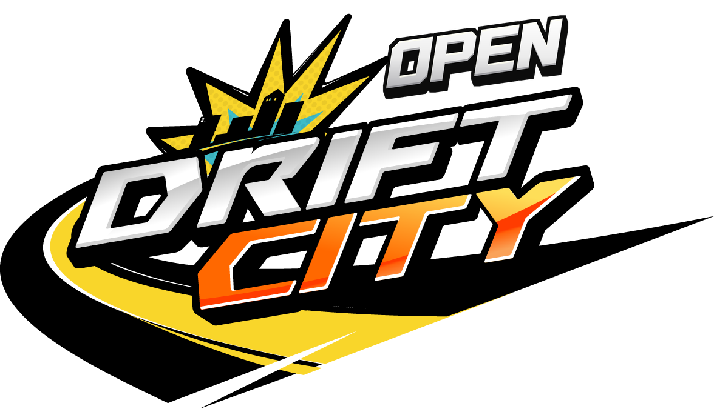
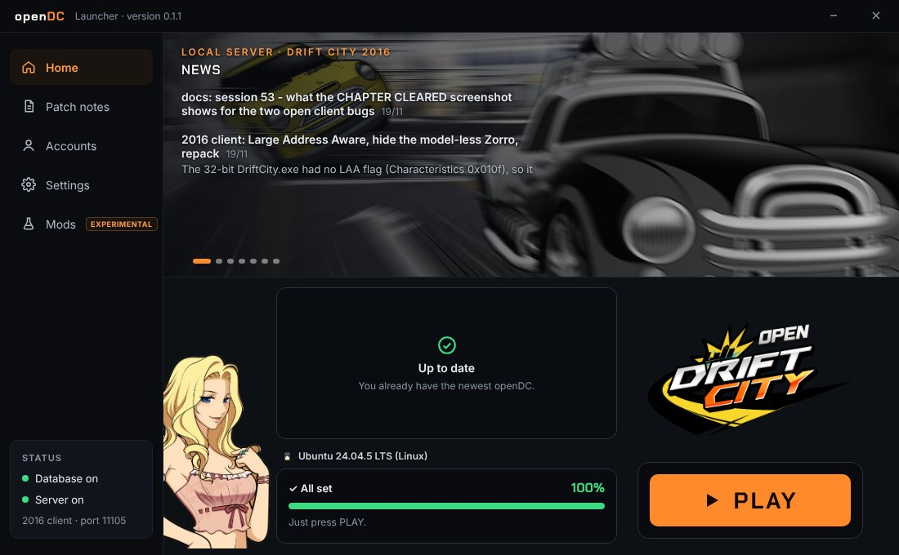
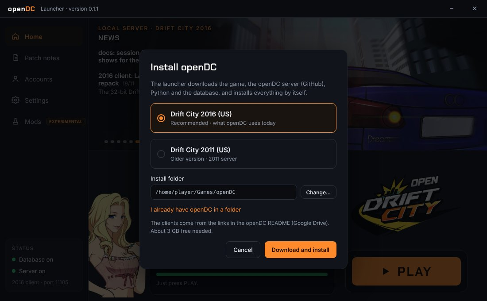
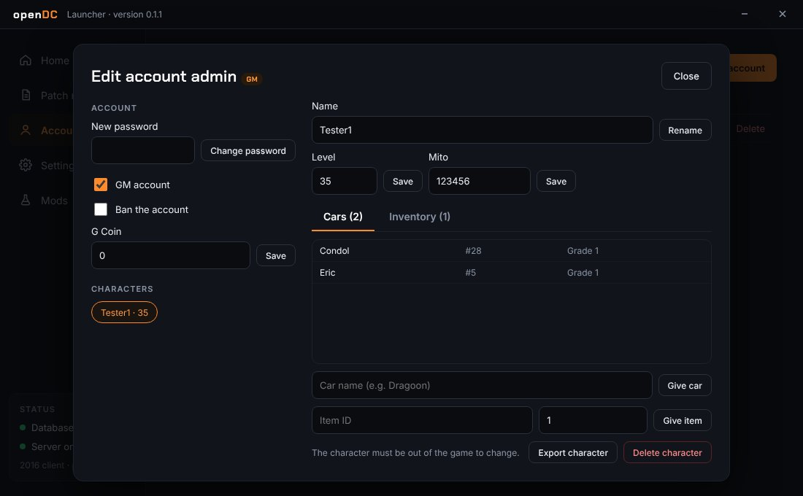
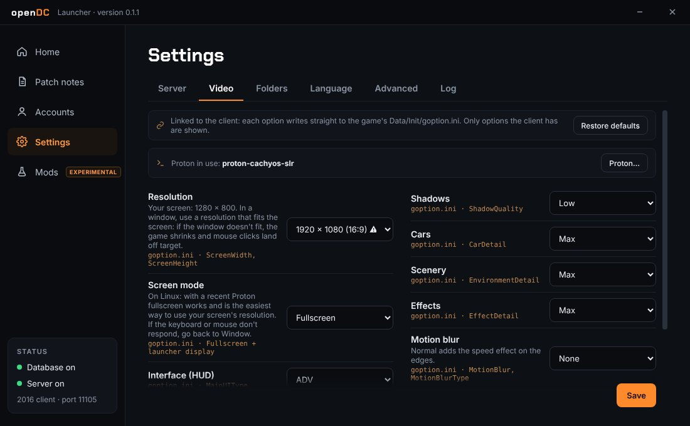

# openDC



Drift City (Skid Rush) Stage 2/Stage 3 Emulation Project: a server emulator for the **2011 (2016 in development as well) Drift City client**: the US version.

**DISCLAIMER: This project is coded with AI models (vibecoded)**

**It's still work in progress, so expect bugs and features not working ideally the way they should!**

The emulator is a native server written in Python. It keeps the original server's architecture from the leaked 2008 files (separate auth /
lobby / game / area / battle-area services, the original server's database tables, ported to PostgreSQL), reads the server tables in the
2011/2016 client's own formats, and drives the city traffic, battle zone races, quests, crews, parts shop, auctions and
the rest itself.

## openDC Launcher (Windows / Linux)

<p align="center">
  <a href="https://github.com/Xerender13/openDC/releases?q=launcher&expanded=true"></a>
</p>

One window that downloads and installs everything (the game client, this server, a portable
Python and PostgreSQL) and starts it all with one PLAY button. No Docker, no command line.

<p align="center"></p>

| | Windows | Linux |
|---|---|---|
| **System** | Windows 10 or 11, 64-bit | a 64-bit (x86_64) distribution from the last few years (glibc 2.31+, e.g. Ubuntu 20.04+, Fedora, Arch / CachyOS, SteamOS) |
| **Free space** | about 4 GB (client, server, database) | about 4 GB |
| **Internet** | for the install and the updates | for the install and the updates |
| **Also needed** | nothing else: no Docker, no admin rights | a Proton: the system's (e.g. CachyOS `proton-cachyos-slr`), Steam's, Heroic's or Lutris's, or a GE-Proton downloaded from the launcher. The AppImage needs FUSE (otherwise run it with `--appimage-extract-and-run`) |
| **Graphics** | DirectX 9 | Vulkan (Proton / DXVK) |
| **Start** | extract the zip, open `openDC Launcher.exe` (SmartScreen: *More info* > *Run anyway*) | `chmod +x openDC-Launcher-*.AppImage`, then open it |

What it does:

- **Install**: pick the 2016 or 2011 client and a folder; it downloads the client (the Drive links below), this
  server, Python 3.12 and PostgreSQL 17 and sets up the database. An existing openDC folder can be used as it is.
- **Play**: the database and the server start with the launcher; PLAY opens the game and the launcher waits in the
  tray. Closing the launcher closes the game, the server and the database.
- **Updates**, checked at every start: the server (new commits here), the client (a new link below) and the
  launcher itself.
- **Accounts**: create / delete, password, GM, ban, G Coin; characters: rename, level, Mito, cars, items, give a car
  or an item; export / import an account or a character between installs.
- **Video settings** written into the client's `goption.ini` (resolution up to your screen's, window / fullscreen,
  HUD, quality, motion blur...).
- **Linux**: picks a Proton by itself and has a Proton menu (switch, download GE-Proton, import). **Windows**: fixes
  the cut-off game window with display scaling (125% / 150%) and has buttons for `tools/laa.py` (game memory).
- Portuguese, English and Russian (starts in the system's language).

<table><tr>
<td></td>
<td></td>
<td></td>
</tr><tr><td align="center">Install</td><td align="center">Accounts and characters</td><td align="center">Video settings</td></tr></table>

More: [`DesktopLauncher/README.md`](DesktopLauncher/README.md).

## Client Download

> **With the openDC Launcher you can skip this:** it downloads the client from these links by itself.
> Download by hand only for the manual setup below.

[2011 US client download](https://drive.google.com/file/d/1b1gunQsMlY8gVCuRYVOMm-qadabdkHSl/view?usp=sharing)

[2016 US client download](https://drive.google.com/file/d/16wcIO2xvY--fMb0Gyi787U1cZMwFFUM-/view?usp=sharing)

| Folder | What |
|---|---|
| `Emulator/` | the server: `launch.sh` (Linux) / `launch.bat` (Windows), `docker-compose.yml`, the code in `dcemu/`. Start with [`Emulator/README.md`](Emulator/README.md); the detailed research notes are [`Emulator/docs/EMULATOR_NOTES.md`](Emulator/docs/EMULATOR_NOTES.md) |
| `Launcher/` | source of `DriftCityLauncher` (Go): starts the client against your server; `build.sh` builds the Linux and Windows launchers into each client folder |
| `DesktopLauncher/` | the openDC desktop launcher (Windows 10/11 and Linux): one window that downloads the client, this server, a portable Python and PostgreSQL, and runs everything without Docker. See [`DesktopLauncher/README.md`](DesktopLauncher/README.md) |

## Quick start (manual, with Docker)

> **With the openDC Launcher you can skip this whole section:** it installs the client, the server and the
> database (no Docker) and starts everything with PLAY. The steps below are for running the server by hand.

1. Get the client and unpack it as `Client US` in this folder.
2. Install [Docker Desktop](https://www.docker.com/products/docker-desktop/) (Windows / macOS) or podman / docker
   with compose (Linux; also Python 3.10+).
3. Start it:

   **Windows** (in `Emulator\`):
   ```bat
   launch.bat setup       :: once: builds the emulator image, copies the client's tables
   launch.bat init-db     :: once: an empty database with the account admin / admin
   launch.bat             :: database + emulator + the client
   ```

   **Linux** (in `Emulator/`):
   ```sh
   ./launch.sh setup && ./launch.sh init-db && ./launch.sh
   ```

   The first start asks which client the server is for (2011 US / EU, or 2016 US) and where that client's folder
   is, and copies its tables; `setup` asks again.

4. Log in with `admin` / `admin`, or any new ID and password (accounts are created on first login).

Settings: `Emulator/emulator.ini` (server) and `Client US/DriftCityLauncher.ini` (server address, window mode, HUD).
In the openDC Launcher the same settings are in Settings > Server and Settings > Video.
Moving an existing setup (database, client) to another machine: [`Emulator/docs/HANDOVER.md`](Emulator/docs/HANDOVER.md).
To let other players join, put your address in their `DriftCityLauncher.ini` and in
`Emulator/server_data/serverlist.txt`, and open TCP ports 11005-11051.

## 2011 or 2016

`Emulator/emulator.ini` `[client] version` says which client the server is for: `2016` (the default, experimental) or
`2011` (the US and EU clients). With 2016 the `[2016]` section at the end of the file gives the server its own ports
(111xx) and database, so a second copy of `Emulator/` set to 2011 can run next to it. The 2016 client goes in
`DriftCity Dev Ed/` next to `Emulator/`.

## EU version
The EU version takes the parts, drops, battlezone and channel battle rules from the EU version.
The emulator recognises each client's nation and applies the EU rules only to EU clients (`emulator.ini` `[nation]`;
`allow = eu` or `us` makes a server for one version only).
There is a client switch in launcher (between us and eu) which changes the rules. The EU tables with the different rules exist in the client alongside the US ones.

## Current emulator progress (15.11.2026):

**Features that still work in progress and might work with issues:**
- Seasonal Events
- GT Tournament
- Neo City
- World Lap Time
- DCGP (only started partially)
- Channels and Channel Battle
- Crew management

If you find a bug, something not working not listed above or something working wrongly (not like it was on official servers), creating an issue describing the issue will help the project to improve.
